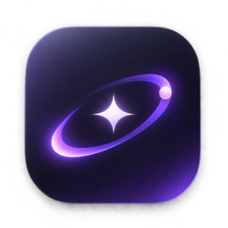
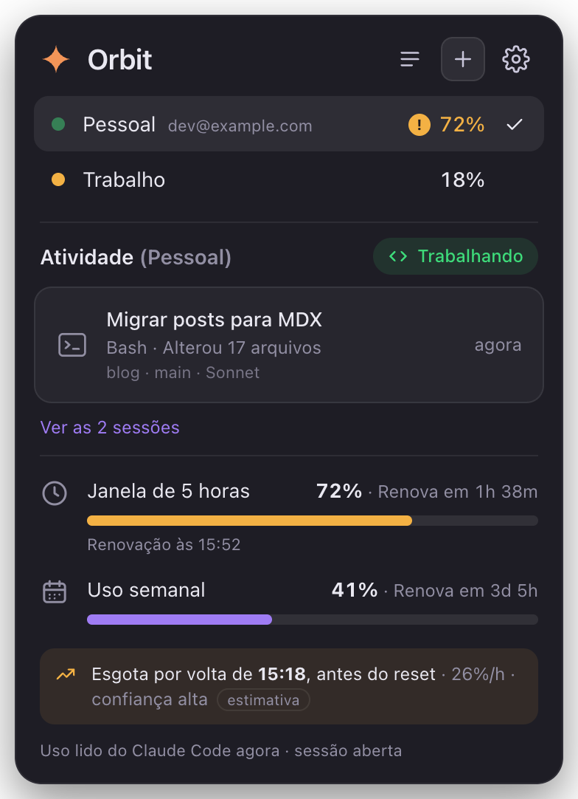
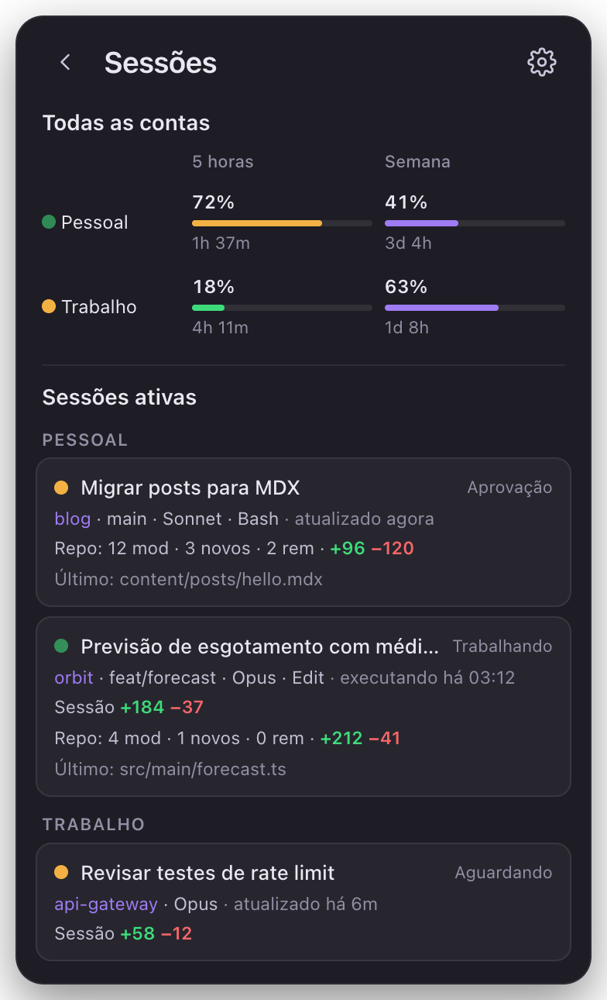

<div align="center">



# Orbit

**Your Claude Code limits, always in sight.**
A menu bar app that shows your 5-hour and weekly usage, counts down to the next reset,
forecasts when you'll run out and tracks every live Claude Code session — across multiple accounts.

[](https://github.com/leandro5g/orbit/releases/latest)
[](https://github.com/leandro5g/orbit/actions/workflows/ci.yml)

[](LICENSE)

[**Download**](https://github.com/leandro5g/orbit/releases/latest) · [Português](README.pt-BR.md)


&nbsp;&nbsp;


</div>

## Features

- **5-hour and weekly limits** per account, with a live countdown to each reset — right in the menu bar.
- **Exhaustion forecast**: at your current pace, when you'll hit 100% and whether it happens before the reset.
- **Multiple accounts**: personal, work, client… every Claude Code config dir is picked up automatically.
- **Live sessions**: working, thinking, waiting for approval, error, done — plus the tool in use.
- **Code changes**: lines written by Claude in the session and uncommitted changes in the repo (git).
- **Native alerts** at the thresholds you choose (50/70/85/95%), on forecast exhaustion, on reset, when a session needs approval or fails.
- **100% local**: no server, no telemetry. Data stays in a local SQLite file.

## Install

Grab the latest build from [**Releases**](https://github.com/leandro5g/orbit/releases/latest):

| System | File |
| --- | --- |
| macOS · Apple Silicon | `Orbit-x.y.z-mac-arm64.dmg` |
| macOS · Intel | `Orbit-x.y.z-mac-x64.dmg` |
| Windows 10/11 | `Orbit-x.y.z-win-x64.exe` |
| Linux | `Orbit-x.y.z-linux-x86_64.AppImage` |

> **macOS:** Orbit isn't notarized by Apple yet. After dragging it to Applications, run
> `xattr -dr com.apple.quarantine /Applications/Orbit.app` once — or open it via
> System Settings → Privacy & Security → *Open Anyway*.

**Requirement:** [Claude Code](https://docs.anthropic.com/en/docs/claude-code) installed and logged in.

## How it works

Orbit never asks for your password and never reads or stores tokens. Everything that talks to Anthropic goes
through the official `claude` binary, with your own login:

- **Usage** comes from running `claude -p /usage` locally (no tokens spent), every few minutes.
- **Accounts** are Claude Code config dirs (`CLAUDE_CONFIG_DIR`). Orbit finds `~/.claude` and `~/.claude-*` on its own.
  **+ → New account** creates a new dir and opens the Terminal for the official Claude Code login.
- **Session details** (optional): one click installs a statusline and hooks — with a backup of your
  `settings.json` — to get approval/error states, the tool in use and real-time usage.

Details on what is read and installed: [docs/integracao.md](docs/integracao.md) (Portuguese).

## Development

```bash
npm install
npm run dev          # run with hot reload
npm test             # unit tests (forecast, states, parser, installer)
npm run dist:mac     # or dist:win / dist:linux → dist/
```

Stack: Electron · React · TypeScript · Vite · Zustand · SQLite (`node:sqlite`).

Useful env vars: `ORBIT_DEMO=1` (fake data, for screenshots), `ORBIT_OPEN=1` (open the popover on start),
`ORBIT_DEBUG=1` (log `/usage` reads).

### Releasing

Push a tag and GitHub Actions builds macOS, Windows and Linux and publishes the release:

```bash
npm version patch && git push --follow-tags
```

## Status

Early MVP. Built and tested on macOS; Windows and Linux builds are produced by CI but still lightly tested —
issues and PRs welcome. The UI is in Portuguese for now.

Orbit is an independent project, not affiliated with Anthropic. "Claude" and "Claude Code" are trademarks of Anthropic.

## License

[MIT](LICENSE) © Leandro Moraes
