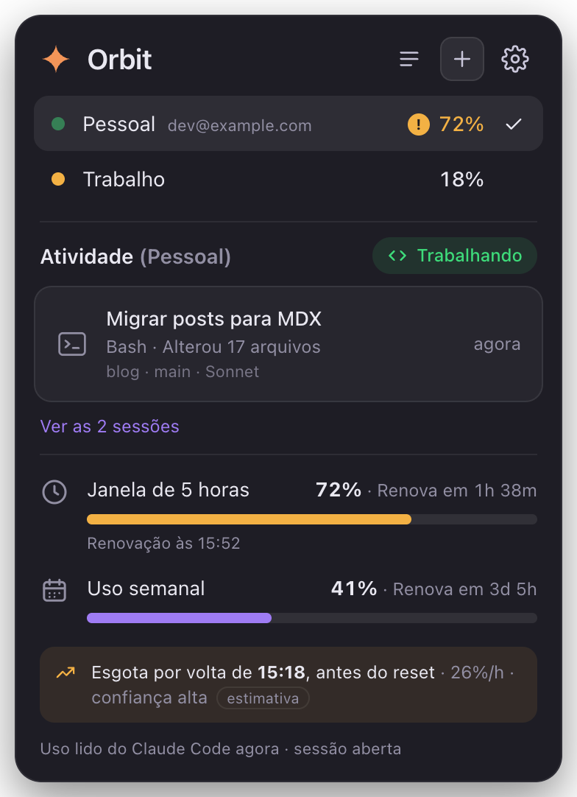
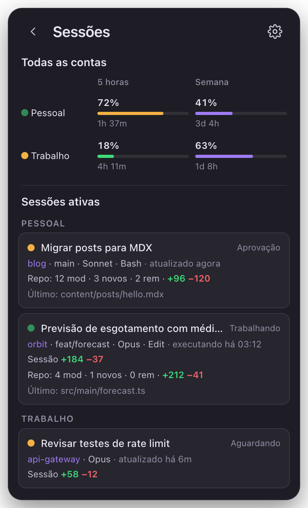

<div align="center">


# Orbit

**Seus limites do Claude Code sempre à vista.**
App de barra de menus que mostra o uso de 5 horas e semanal, conta o tempo até o próximo reset,
prevê quando você vai esgotar e acompanha cada sessão aberta do Claude Code, em várias contas.

[](https://github.com/leandro5g/orbit/releases/latest)
[](https://github.com/leandro5g/orbit/actions/workflows/ci.yml)
[](LICENSE)

[**Baixar**](https://github.com/leandro5g/orbit/releases/latest) · [English](README.md)


&nbsp;&nbsp;


</div>

## O que ele faz

- **Limites de 5h e semanal** por conta, com contagem regressiva até cada reset, na barra de menus.
- **Previsão de esgotamento**: no ritmo atual, quando chega a 100% e se isso acontece antes do reset.
- **Várias contas**: pessoal, trabalho, cliente… cada pasta do Claude Code é encontrada sozinha.
- **Sessões ao vivo**: trabalhando, pensando, pedindo aprovação, erro, concluída, e a ferramenta em uso.
- **Alterações de código**: linhas escritas pelo Claude na sessão e alterações não commitadas no repo (git).
- **Alertas nativos** nos limiares que você escolher (50/70/85/95%), na previsão de esgotamento, no reset,
  quando uma sessão pede aprovação ou dá erro.
- **Tudo local**: sem servidor e sem telemetria. Os dados ficam num SQLite na sua máquina.

## Instalar

Baixe a versão mais recente em [**Releases**](https://github.com/leandro5g/orbit/releases/latest):

| Sistema | Arquivo |
| --- | --- |
| macOS · Apple Silicon | `Orbit-x.y.z-mac-arm64.dmg` |
| macOS · Intel | `Orbit-x.y.z-mac-x64.dmg` |
| Windows 10/11 | `Orbit-x.y.z-win-x64.exe` |
| Linux | `Orbit-x.y.z-linux-x86_64.AppImage` |

> **macOS:** o Orbit ainda não é notarizado pela Apple. Depois de arrastar para Aplicativos, rode uma vez
> `xattr -dr com.apple.quarantine /Applications/Orbit.app`, ou abra por
> Ajustes do Sistema → Privacidade e Segurança → *Abrir Mesmo Assim*.

**Requisito:** [Claude Code](https://docs.anthropic.com/en/docs/claude-code) instalado e com login feito.

## Como funciona

O Orbit nunca pede senha e nunca lê nem guarda tokens. Tudo o que fala com a Anthropic passa pelo binário
oficial `claude`, com o seu login:

- **Uso**: o Orbit roda `claude -p /usage` localmente (não gasta tokens) a cada poucos minutos.
- **Contas** são pastas do Claude Code (`CLAUDE_CONFIG_DIR`). O Orbit acha `~/.claude` e `~/.claude-*` sozinho.
  **+ → Nova conta** cria a pasta e abre o Terminal para o login oficial do Claude Code.
- **Detalhes das sessões** (opcional): um clique instala statusline e hooks, com backup do `settings.json`,
  para ter aprovação, erro, ferramenta em uso e uso em tempo real.

O que é lido e instalado: [docs/integracao.md](docs/integracao.md).

## Desenvolvimento

```bash
npm install
npm run dev          # desenvolvimento com hot reload
npm test             # testes (previsão, estados, parser, instalador)
npm run dist:mac     # ou dist:win / dist:linux → dist/
```

Stack: Electron · React · TypeScript · Vite · Zustand · SQLite (`node:sqlite`).

```
src/main/        processo principal: coleta e menu bar
  accounts.ts      descoberta das contas e identidade
  claude-cli.ts    acha o binário, roda /usage, abre o login no Terminal
  usage-text.ts    parser do texto do /usage
  usage.ts         leitura da statusline + amostras no SQLite
  forecast.ts      previsão de esgotamento
  sessions.ts      sessões abertas, pid, hooks
  state.ts         estado da sessão a partir de status + hook
  git.ts           alterações por repositório
  integration.ts   instalador da statusline e dos hooks
  notifications.ts alertas nativos
  demo.ts          dados fictícios (ORBIT_DEMO=1)
src/preload/     ponte IPC
src/renderer/    popover (React + Zustand)
src/shared/      tipos e formatação
```

Variáveis úteis: `ORBIT_DEMO=1` (dados fictícios, para prints), `ORBIT_OPEN=1` (abre o popover ao iniciar),
`ORBIT_CAPTURE=/tmp/x.png` (grava um print do popover), `ORBIT_DEBUG=1` (loga as leituras do `/usage`).

### Publicar uma versão

Ao subir uma tag, o GitHub Actions gera os builds de macOS, Windows e Linux e publica a release:

```bash
npm version patch && git push --follow-tags
```

## Status

MVP. Feito e testado no macOS; os builds de Windows e Linux saem do CI, mas ainda foram pouco testados.
Issues e PRs são bem-vindos.

O Orbit é um projeto independente, sem vínculo com a Anthropic. "Claude" e "Claude Code" são marcas da Anthropic.

## Licença

[MIT](LICENSE) © Leandro Moraes
